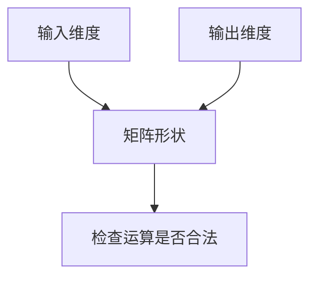

## 先抓住这个直觉

**一行权重算一个输出**。可以把矩阵看成几台共享输入的小计算器。接下来改输入，看看两个输出怎样一起变化。

- 形状由输入和输出维度决定。
- 具体数值是另一回事，会在训练中调整。

| 你在问什么 | 由什么决定 | 一个例子 |
| :--- | :--- | :--- |
| 为什么是 2×3 | 3 个输入、2 个输出 | 每行需要 3 个权重 |
| 为什么是这些数 | 初始化及训练 | 权重从初值逐步调整 |

行内公式 $y=Wx+b$；按列向量约定：

$$
\underbrace{\begin{bmatrix}1&2\\3&4\end{bmatrix}}_{W\in\mathbb{R}^{2\times2}}
\underbrace{\begin{bmatrix}1\\2\end{bmatrix}}_{x}
=\begin{bmatrix}5\\11\end{bmatrix}
$$

```python
# 每行做一次加权求和
result = [sum(w * x for w, x in zip(row, inputs)) for row in weights]
```

### 从观察到掌握

```reading-pet
{"type":"steps","title":"弄懂一行的工作","items":[{"title":"看一次计算","body":"将一行权重与输入逐项相乘再求和。"},{"title":"自己改一个输入","body":"观察每个输出如何变化，检查你的预测。"},{"title":"回到文章继续读","body":"记住一行对应一个输出，不必现在展开所有训练算法。"}]}
```

### 理解与积累怎样连接

```reading-pet
{"type":"flow","title":"阅读中的两个循环","direction":"TD","nodes":[{"id":"read","label":"划出疑惑","group":"理解"},{"id":"try","label":"解释并尝试","group":"理解"},{"id":"note","label":"整理理解","group":"积累"},{"id":"reuse","label":"联系旧知识","group":"积累"}],"edges":[{"from":"read","to":"try"},{"from":"try","to":"note"},{"from":"note","to":"reuse"},{"from":"reuse","to":"read","label":"下次阅读"}]}
```

也可以用简单关系图：



下面是静态 SVG 示意：

```svg
<svg xmlns="http://www.w3.org/2000/svg" viewBox="0 0 400 110"><rect x="10" y="20" width="100" height="65" rx="10" fill="#e9f0df"/><text x="60" y="59" text-anchor="middle" font-family="sans-serif" font-size="17" fill="#294e3d">输入 x</text><path d="M115 52H270" stroke="#8da178" stroke-width="2"/><text x="192" y="42" text-anchor="middle" fill="#4c6741" font-size="14">权重 W</text><rect x="280" y="20" width="110" height="65" rx="10" fill="#e9f0df"/><text x="335" y="59" text-anchor="middle" font-family="sans-serif" font-size="17" fill="#294e3d">输出 y</text></svg>
```

### 动手改一个输入

先选第二行，再拖动 $x_1$，观察这一行如何决定第二个输出。

```reading-pet
{"type":"matrix","title":"每行计算一个输出","matrix":[[1,2],[3,4]],"vector":[1,2]}
```

### 看高频片段如何变短

点击下一步，观察符号合并；这只是字符级教学示意。

```reading-pet
{"type":"bpe","title":"BPE 的词表与长度取舍","text":"low lowest","corpus":[{"text":"low","count":5},{"text":"lowest","count":3}],"merges":5}
```

### 用参数验证一个设计代价

这里仅计算一张 embedding 表，未计算梯度、优化器和其他模型参数。

```reading-pet
{"type":"calculator","title":"词表扩大要付出多少参数","inputs":[{"key":"v","label":"词表大小","min":1000,"max":100000,"step":1000,"value":32000,"unit":"项"},{"key":"d","label":"向量维度","min":64,"max":4096,"step":64,"value":512,"unit":"维"}],"outputs":[{"label":"Embedding 参数量","expression":"v*d","unit":"个","digits":0},{"label":"FP16 存储","expression":"v*d*2/1024^2","unit":"MiB","digits":2}]}
```

### 看原文中的图片


下面的外部图片需点击才加载：


### 需要时再生成一张图

```reading-pet
{"type":"generate-image","title":"用两台计算器理解两行权重","prompt":"一张清爽的教学插画：两个绿色计算器共享三个输入，分别输出一个数。以线条清楚展示每个输出依赖全部输入，背景浅米色，中文标注简短。","alt":"AI 生成示意：每一行分别计算一个输出"}
```
